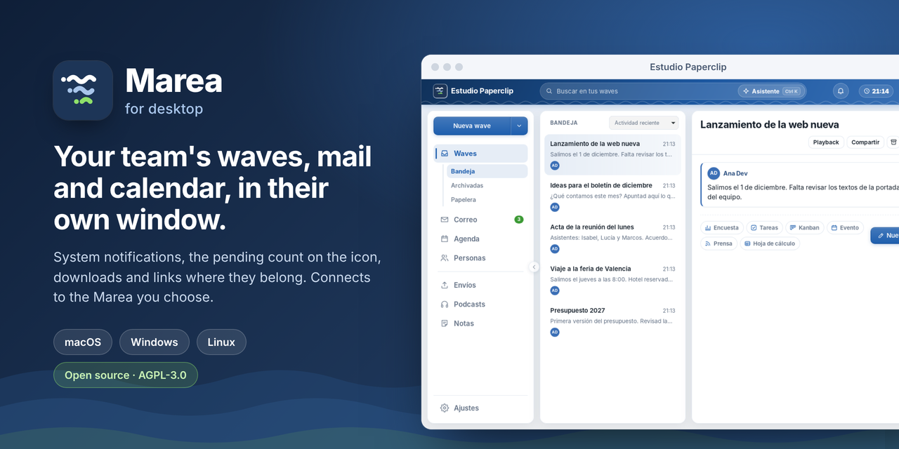
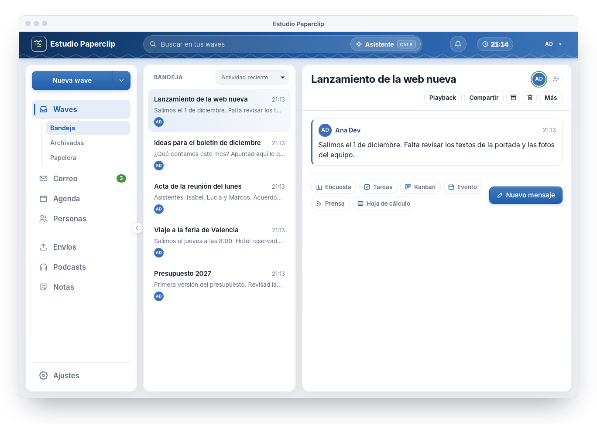
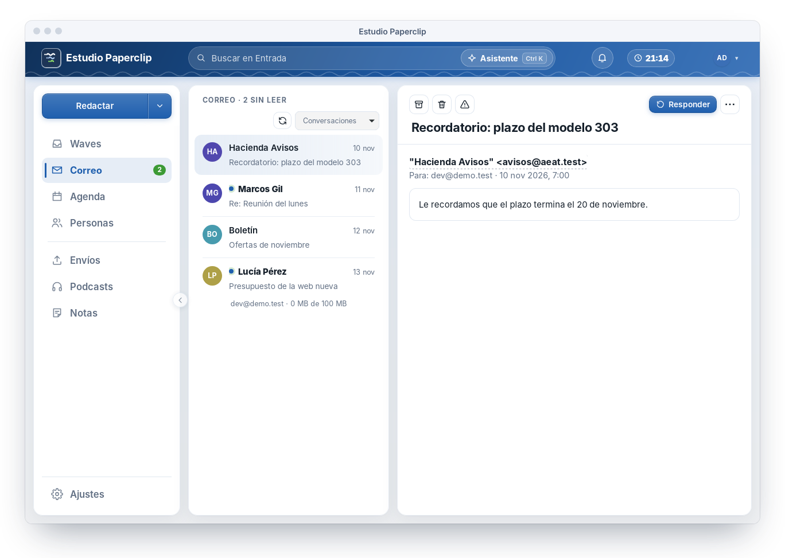
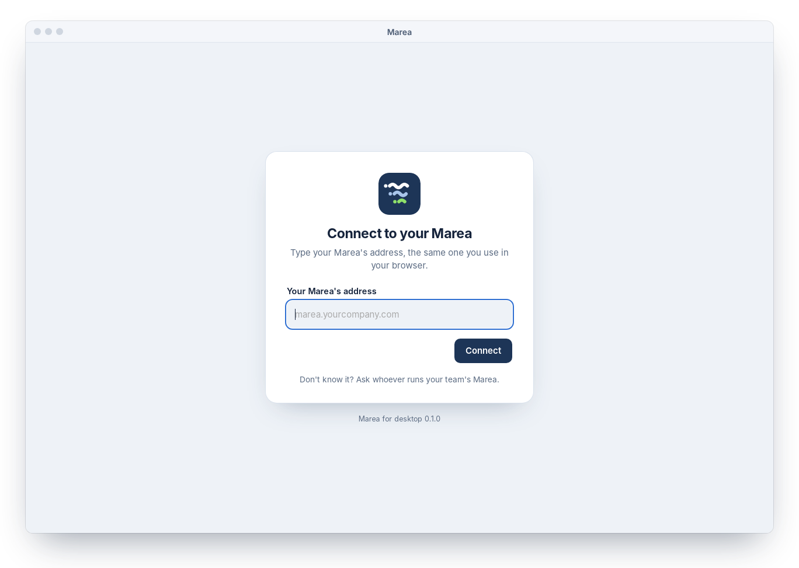
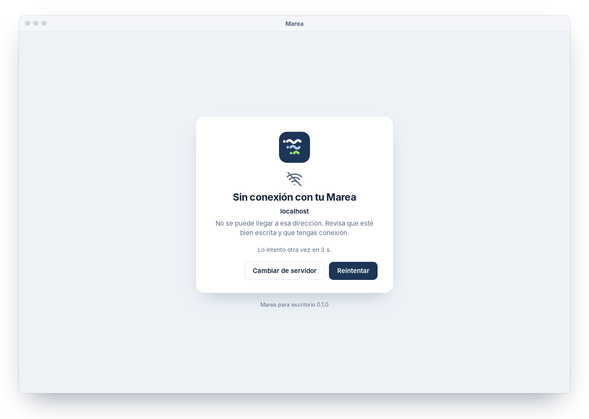
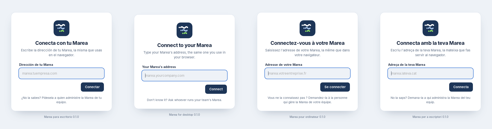

<p align="center"></p>

<p align="center">
  <a href="https://github.com/mareabypaperclip/marea-desktop/releases/latest"></a>
  <a href="https://github.com/mareabypaperclip/marea-desktop/actions/workflows/ci.yml"></a>
  
  <a href="LICENSE"></a>
  <a href="https://v2.tauri.app"></a>
</p>

<p align="center">
  <b><a href="https://github.com/mareabypaperclip/marea-desktop/releases/latest">Descargar</a></b> ·
  <a href="#qué-hace">Qué hace</a> ·
  <a href="#seguridad-y-privacidad">Seguridad</a> ·
  <a href="#preguntas-frecuentes">Preguntas</a> ·
  <a href="README.md">English</a>
</p>

---

[Marea](https://github.com/mareabypaperclip/marea) es un espacio autoalojado para las conversaciones, el correo, la
agenda y los contactos de un equipo. **Marea para escritorio** abre la Marea que elijas (la de tu empresa o la
tuya) en una ventana de aplicación de verdad y añade lo que una pestaña del navegador no puede. Es ligera, arranca
rápido y usa el motor web que ya trae tu sistema.

<p align="center"></p>

## Qué hace

- **Una aplicación propia.** Su ventana y su icono en el Dock, la barra de tareas o el lanzador. En macOS, la
  barra azul de Marea llega hasta arriba, con los botones de la ventana dentro. Recuerda el tamaño y la posición,
  puede abrirse al iniciar sesión (lista, en segundo plano) y, si la abres otra vez, vuelve a mostrar la ventana.
- **Avisos del sistema** de mensajes nuevos, menciones, recordatorios de la agenda y llamadas, con el nombre y el
  icono de la aplicación, cuando la ventana no está delante. Respeta lo que hayas elegido en cada wave
  (silenciada, solo menciones, pospuesta), y si vuelves a la ventana justo después de un aviso, abre esa wave.
- **Los pendientes en el icono:** un número en el icono del Dock en macOS y en el botón de la barra de tareas en
  Windows (en Linux, donde tu escritorio lo muestre).
- **Siempre a mano.** Al cerrar la ventana, Marea sigue abierta en el Dock (macOS) o junto al reloj (Windows y
  Linux), y los recordatorios y las llamadas te siguen llegando. *Salir de Marea* la cierra del todo.
- **Archivos y enlaces en su sitio.** Las descargas van directas a tu carpeta de Descargas, con un aviso al terminar.
  Los enlaces a otras webs se abren en tu navegador de siempre; entrar con Google o Microsoft se queda dentro.
- **Una pantalla tranquila sin conexión.** Si se va la red o el servidor, te lo dice, lo reintenta sola y te vuelve
  a meter en cuanto puede.
- **Cámara, micrófono y ubicación** para las llamadas y el tiempo, siempre con el permiso de tu sistema.
- **Habla tu idioma:** español, inglés, francés y catalán, según tu sistema.
- **Atajos a toda Marea.** En macOS, la barra de menús tiene *Nueva wave* (<kbd>⌘</kbd><kbd>N</kbd>), *Redactar
  correo* (<kbd>⇧</kbd><kbd>⌘</kbd><kbd>N</kbd>), *Buscar* (<kbd>⌘</kbd><kbd>F</kbd>), el Asistente y un menú *Ir*
  con todas las secciones (<kbd>⌘</kbd><kbd>1</kbd> a <kbd>⌘</kbd><kbd>7</kbd>). En Windows y Linux,
  <kbd>Ctrl</kbd> <kbd>1</kbd> a <kbd>7</kbd> abren las secciones, y el icono junto al reloj tiene nueva wave,
  redactar correo, correo y agenda. Zoom con <kbd>Ctrl</kbd>/<kbd>⌘</kbd> <kbd>+</kbd> y <kbd>-</kbd>.
- **Avisa de las versiones nuevas** sin agobiar: una vez, y otra solo si pasados tres días no has actualizado.

<p align="center">
  
</p>

## Descargar

Descarga la última versión en **[Releases](https://github.com/mareabypaperclip/marea-desktop/releases/latest)**:

| Sistema | Archivo |
| --- | --- |
| macOS 11 Big Sur o posterior (Apple Silicon e Intel) | `Marea_x.y.z_universal.dmg` |
| Windows 10 y 11 | `Marea_x.y.z_x64-setup.exe` |
| Debian, Ubuntu, Linux Mint | `Marea_x.y.z_amd64.deb` |
| Fedora, openSUSE | `Marea-x.y.z-1.x86_64.rpm` |
| Cualquier otro Linux | `Marea_x.y.z_amd64.AppImage` |

Los instaladores aún no van firmados, así que la primera vez hace falta un clic más:

- **macOS:** si dice que no se puede abrir Marea, ve a *Ajustes del Sistema → Privacidad y seguridad* y elige
  *Abrir igualmente*.
- **Windows:** si SmartScreen dice *Windows protegió su PC*, elige *Más información → Ejecutar de todas formas*.
- **AppImage de Linux:** dale antes permiso de ejecución (`chmod +x Marea_*.AppImage`).

En Windows se instala solo para tu usuario, así que no pide permisos de administrador. Si falta WebView2 (raro en
Windows 10, nunca en Windows 11), el instalador lo descarga.

## La primera vez

Escribe la dirección de tu Marea, la misma que usas en el navegador, y pulsa *Conectar*. La aplicación comprueba que
de verdad es una Marea antes de abrirla y la recuerda. Para cambiar a otra más adelante, usa *Marea → Cambiar de
servidor…* en macOS o el icono junto al reloj en Windows y Linux.

<p align="center">
  
  
</p>

<p align="center"></p>

## Seguridad y privacidad

- **Solo dos destinos.** La aplicación habla con la Marea que elegiste y, para buscar versiones nuevas, con la API
  pública de GitHub. No hay analíticas, ni telemetría, ni cuentas nuestras.
- **Solo https.** Rechaza direcciones sin https (salvo `localhost`, para desarrollo) y servidores que redirigen a
  otro sitio.
- **Los permisos mínimos.** Tu Marea puede pedirle a la aplicación muy pocas cosas: *muestra este aviso*, *abre
  este enlace en el navegador* y, en macOS, *¿dónde estoy?* (con el aviso de permiso del propio sistema) y
  *mueve la ventana* (desde su barra de arriba). Se le conceden a su dirección exacta al conectar, y a nada más.
  Otras webs no los tienen, y nada puede leer tus archivos.
- **Tus datos se quedan en Marea.** La aplicación solo guarda la dirección del servidor y la posición de la
  ventana. Tu sesión vive en el motor web del sistema, como en un navegador.
- **Código abierto** con licencia AGPL, compilado a la vista de todos por
  [GitHub Actions](.github/workflows/release.yml) desde este repositorio.

¿Has encontrado un problema de seguridad? Sigue [SECURITY.md](SECURITY.md) en vez de abrir una incidencia pública.

## Preguntas frecuentes

<details>
<summary><b>¿Necesito mi propio servidor de Marea?</b></summary>

Sí. Esta aplicación es una ventana a una instalación de Marea; no la incluye. Si tu empresa usa Marea, pide la
dirección a quien la lleve. Para montar la tuya, mira el [repositorio de Marea](https://github.com/mareabypaperclip/marea).
</details>

<details>
<summary><b>¿Puedo usarla con más de una Marea?</b></summary>

Con una cada vez. *Cambiar de servidor…* pasa de una a otra, y cada una conserva su sesión.
</details>

<details>
<summary><b>¿Funciona sin conexión?</b></summary>

La aplicación se abre, te dice que no llega a tu Marea y vuelve a conectar sola. Leer Marea sin conexión está en
la hoja de ruta de Marea.
</details>

<details>
<summary><b>¿Por qué me avisa el sistema la primera vez?</b></summary>

Porque los instaladores aún no van firmados. Firmarlos exige un certificado de pago de Apple y otro para Windows;
está previsto. Cada instalador lo compilan los flujos públicos de este repositorio, así que puedes ver exactamente
cómo se hizo.
</details>

<details>
<summary><b>¿Se actualiza sola?</b></summary>

Todavía no. Te avisa cuando hay una versión nueva y abre la página de descarga; instálala encima de la anterior y
tus ajustes se conservan.
</details>

## Compilarla tú

Necesitas [Rust](https://rustup.rs) (estable), Node.js 22 y los
[requisitos de Tauri](https://v2.tauri.app/start/prerequisites/) de tu sistema.

```sh
npm ci
npx tauri build                       # instaladores en src-tauri/target/release/bundle
npx tauri build --debug --no-bundle   # una compilación rápida para probar
```

Antes de mandar cambios:

```sh
cd src-tauri
cargo fmt --check && cargo clippy --all-targets -- -D warnings && cargo test
```

Cómo está hecha por dentro, y sus límites conocidos, están en [NOTES.md](NOTES.md) (en inglés). Las
contribuciones, y sobre todo las traducciones, son bienvenidas: mira [CONTRIBUTING.md](CONTRIBUTING.md).

## Licencia

[GNU Affero General Public License v3.0 o posterior](LICENSE). © 2026 Paperclip.
Marea y su logotipo son parte del proyecto [Marea](https://github.com/mareabypaperclip/marea).
