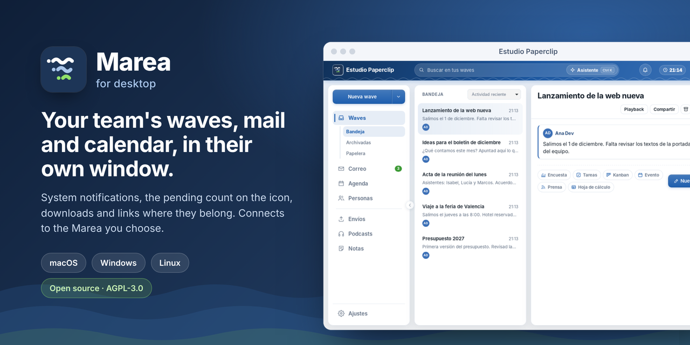
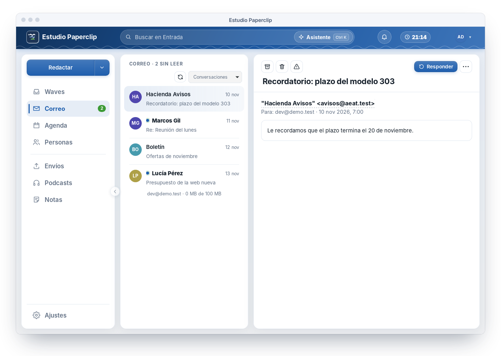
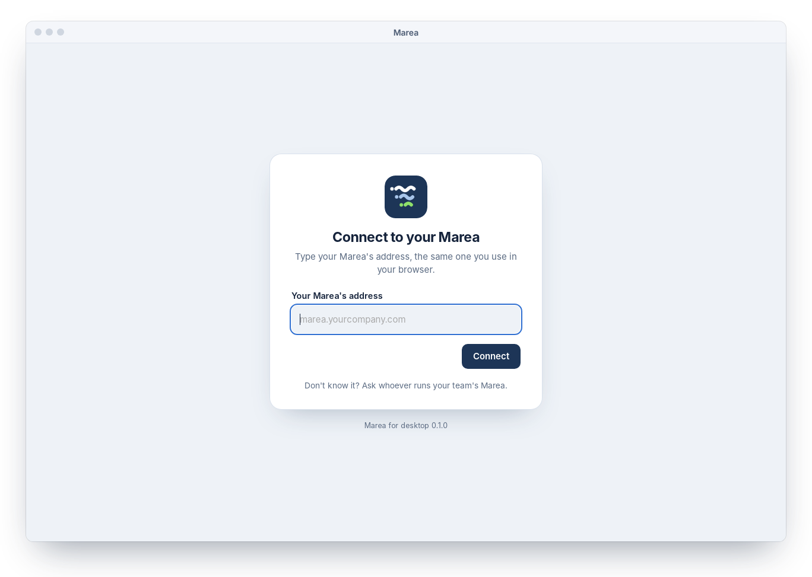
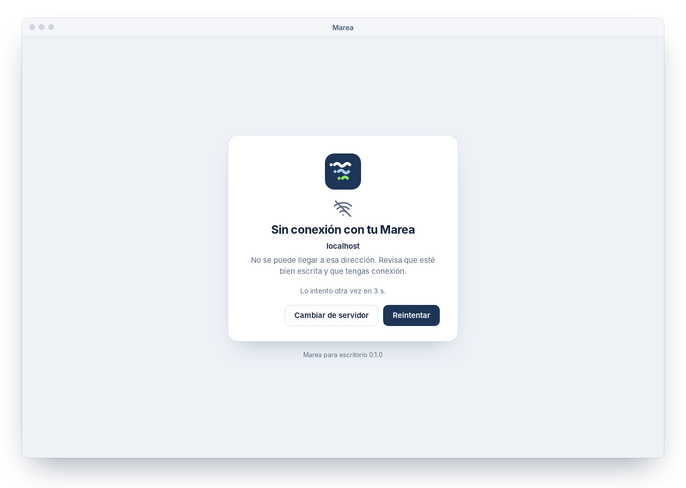
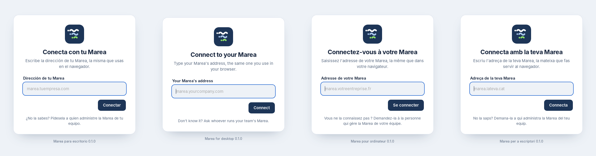

<p align="center"></p>

<p align="center">
  <a href="https://github.com/mareabypaperclip/marea-desktop/releases/latest"></a>
  <a href="https://github.com/mareabypaperclip/marea-desktop/actions/workflows/ci.yml"></a>
  
  <a href="LICENSE"></a>
  <a href="https://v2.tauri.app"></a>
</p>

<p align="center">
  <b><a href="https://github.com/mareabypaperclip/marea-desktop/releases/latest">Download</a></b> ·
  <a href="#features">Features</a> ·
  <a href="#security-and-privacy">Security</a> ·
  <a href="#faq">FAQ</a> ·
  <a href="README.es.md">Español</a>
</p>

---

[Marea](https://github.com/mareabypaperclip/marea) is a self-hosted home for a team's conversations, mail, calendar
and contacts. **Marea for desktop** opens the Marea you choose (your company's, or your own) in a real app window,
and adds what a browser tab can't. It's small, it starts fast and it uses the web engine your system already has.

<p align="center"></p>

## Features

- **An app of its own.** Its own window and icon in the Dock, the taskbar or your launcher. On macOS, Marea's
  blue bar reaches the top of the window, with the window buttons inside it. It remembers its size and position,
  can open at login (ready in the background), and a second launch just brings the window back.
- **Notifications from the system** for new messages, mentions, calendar reminders and calls, with the app's
  name and icon, while the window isn't in front. Each wave's own setting (muted, mentions only, snoozed) is
  respected, and coming back to the window right after one opens that wave.
- **The pending count on the icon:** unread waves and unread mail, as a number on the Dock icon on macOS and on
  the taskbar button on Windows (on Linux, wherever your desktop shows it).
- **Stays reachable.** Closing the window keeps Marea running in the Dock (macOS) or next to the clock (Windows and
  Linux), so reminders and calls still reach you. *Quit Marea* closes it for real.
- **Files and links where they belong.** Downloads go straight to your Downloads folder with a notification when
  they finish. Links to other sites open in your usual browser; signing in with Google or Microsoft stays inside.
- **A calm offline screen.** If the network or the server goes away, the app says so, retries on its own and gets
  you back in as soon as it can.
- **Camera, microphone and location** for calls and the weather, each behind your system's own permission.
- **Speaks your language:** English, Spanish, French and Catalan, picked from your system.
- **Shortcuts to all of Marea.** On macOS, the menu bar has *New Wave* (<kbd>⌘</kbd><kbd>N</kbd>), *Compose
  Mail* (<kbd>⇧</kbd><kbd>⌘</kbd><kbd>N</kbd>), *Search* (<kbd>⌘</kbd><kbd>F</kbd>), the Assistant and a *Go* menu
  with every section (<kbd>⌘</kbd><kbd>1</kbd> to <kbd>⌘</kbd><kbd>7</kbd>). On Windows and Linux, <kbd>Ctrl</kbd>
  <kbd>1</kbd> to <kbd>7</kbd> open the sections, and the icon next to the clock has new wave, compose, mail and
  calendar. Zoom with <kbd>Ctrl</kbd>/<kbd>⌘</kbd> <kbd>+</kbd> and <kbd>-</kbd>.
- **Tells you about new versions** without nagging: once, and again only after three days if you haven't updated.

<p align="center">
  
</p>

## Download

Get the latest version from **[Releases](https://github.com/mareabypaperclip/marea-desktop/releases/latest)**:

| System | File |
| --- | --- |
| macOS 11 Big Sur or later (Apple Silicon and Intel) | `Marea_x.y.z_universal.dmg` |
| Windows 10 and 11 | `Marea_x.y.z_x64-setup.exe` |
| Debian, Ubuntu, Linux Mint | `Marea_x.y.z_amd64.deb` |
| Fedora, openSUSE | `Marea-x.y.z-1.x86_64.rpm` |
| Any other Linux | `Marea_x.y.z_amd64.AppImage` |

The installers aren't code-signed yet, so the first launch needs one extra click:

- **macOS:** if it says Marea can't be opened, go to *System Settings → Privacy & Security* and choose
  *Open Anyway*.
- **Windows:** if SmartScreen says *Windows protected your PC*, choose *More info → Run anyway*.
- **Linux AppImage:** make it executable first (`chmod +x Marea_*.AppImage`).

Windows installs for your user only, so it doesn't need administrator rights. If the WebView2 runtime is missing
(rare on Windows 10, never on Windows 11), the installer downloads it.

## First launch

Type your Marea's address, the same one you use in the browser, and press *Connect*. The app checks that it
really is a Marea before opening it, and remembers it. To switch to another one later, use *Marea → Change Server…*
on macOS or the icon next to the clock on Windows and Linux.

<p align="center">
  
  
</p>

<p align="center"></p>

## Security and privacy

- **Only two destinations.** The app talks to the Marea you chose and, to look for new versions, to GitHub's
  public API. There are no analytics, no telemetry and no accounts of ours.
- **https only.** The app refuses addresses without https (except `localhost`, for development) and refuses
  servers that redirect somewhere else.
- **The smallest set of permissions.** Your Marea can ask the app for very few things: *show this
  notification*, *open this link in the browser*, *put this number on the icon* and, on macOS, *where am I?*
  (behind the system's own prompt) and *move the window* (from its top bar). They are granted to its exact
  address when you connect, and to nothing else. Other sites never get them, and nothing can read your files.
- **Your data stays in Marea.** The app keeps only the server address and the window position. Your session
  lives in the system web engine, as it would in a browser.
- **Open source** under the AGPL, built in public by [GitHub Actions](.github/workflows/release.yml) from this
  repository.

Found a security problem? Please follow [SECURITY.md](SECURITY.md) instead of opening a public issue.

## FAQ

<details>
<summary><b>Do I need my own Marea server?</b></summary>

Yes. This app is a window onto a Marea installation; it doesn't include one. If your company uses Marea, ask
whoever runs it for the address. To run your own, see the [Marea repository](https://github.com/mareabypaperclip/marea).
</details>

<details>
<summary><b>Can I use it with more than one Marea?</b></summary>

One at a time. *Change Server…* switches between them, and each keeps its own session.
</details>

<details>
<summary><b>Does it work without a connection?</b></summary>

The app opens and tells you it can't reach your Marea, then connects again by itself. Reading Marea offline is on
Marea's roadmap.
</details>

<details>
<summary><b>Why does my system warn me the first time?</b></summary>

Because the installers aren't code-signed yet. Signing needs a paid certificate from Apple and another for
Windows; it's planned. Every installer is built by this repository's public workflows, so you can see exactly how
it was made.
</details>

<details>
<summary><b>Does it update itself?</b></summary>

Not yet. It tells you when there's a new version and opens the download page; install it over the old one and
your settings stay.
</details>

## Build from source

You need [Rust](https://rustup.rs) (stable), Node.js 22 and the
[Tauri prerequisites](https://v2.tauri.app/start/prerequisites/) for your system.

```sh
npm ci
npx tauri build                       # installers in src-tauri/target/release/bundle
npx tauri build --debug --no-bundle   # a quick local build
```

Before sending changes:

```sh
cd src-tauri
cargo fmt --check && cargo clippy --all-targets -- -D warnings && cargo test
```

How it's put together, and the known limitations, are in [NOTES.md](NOTES.md). Contributions, and translations
especially, are welcome: see [CONTRIBUTING.md](CONTRIBUTING.md).

## License

[GNU Affero General Public License v3.0 or later](LICENSE). © 2026 Paperclip.
Marea and the Marea logo are part of the [Marea](https://github.com/mareabypaperclip/marea) project.
