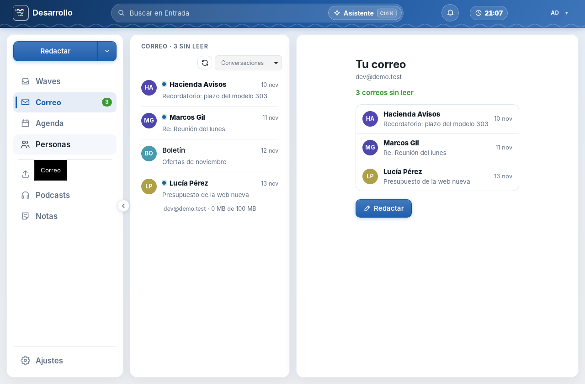
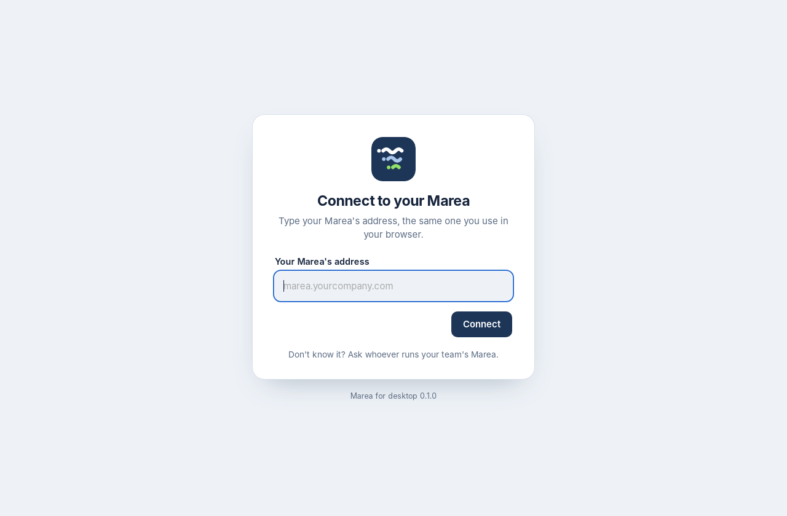
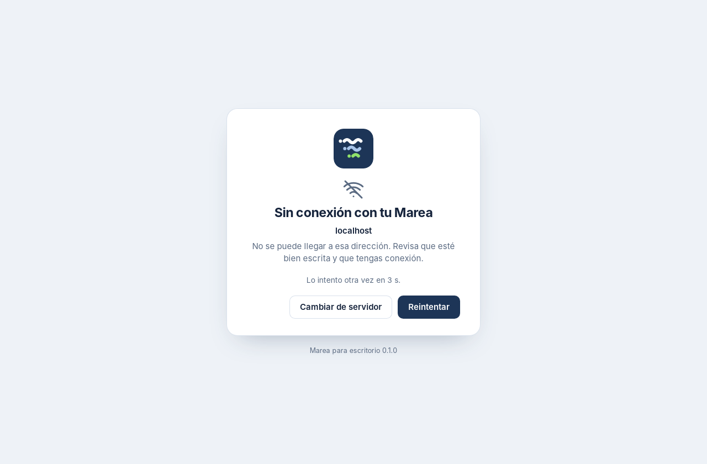

<p align="center"></p>

<h1 align="center">Marea for desktop</h1>

<p align="center">Your Marea in its own window, on macOS, Windows and Linux.</p>

<p align="center"></p>

[Marea](https://github.com/mareabypaperclip/marea) is a self-hosted place for your team's conversations, mail and
calendar. This app opens the Marea you choose (your company's) and adds what a browser tab can't:

- **Its own window and icon** in the Dock, the taskbar or your launcher.
- **System notifications**, and the **pending count on the icon**.
- **Keeps running when you close the window** (in the Dock on macOS, next to the clock on Windows and Linux), so
  notifications keep arriving.
- **Downloads** go straight to your Downloads folder; **links to other sites** open in your browser.
- **A friendly offline screen** that retries on its own and gets you back in as soon as the network returns.
- **Speaks your language:** English, Spanish, French and Catalan, picked from your system.

## Download

Get the latest version from [Releases](https://github.com/mareabypaperclip/marea-desktop/releases/latest):

| System | File |
| --- | --- |
| macOS 11 or later (Apple Silicon and Intel) | `Marea_x.y.z_universal.dmg` |
| Windows 10 and 11 | `Marea_x.y.z_x64-setup.exe` |
| Debian, Ubuntu, Mint | `Marea_x.y.z_amd64.deb` |
| Fedora, openSUSE | `Marea-x.y.z-1.x86_64.rpm` |
| Any Linux | `Marea_x.y.z_amd64.AppImage` |

The installers are not signed yet, so the first launch needs one extra click:

- **macOS:** if it says Marea can't be opened, go to *System Settings → Privacy & Security* and choose *Open Anyway*.
- **Windows:** if SmartScreen says *Windows protected your PC*, choose *More info → Run anyway*.

## First launch

Type your Marea's address (the same one you use in the browser) and press *Connect*. The app checks that it
really is a Marea and remembers it. To switch to another one later: *Marea → Change Server…* on macOS, or the
icon next to the clock on Windows and Linux.

<p align="center">
  
  
</p>

## Security and privacy

- The app only talks to the Marea you chose (over https) and, to look for new versions, to GitHub.
- Your Marea can ask the app for exactly two things: *show this notification* and *open this link in the browser*.
  Those permissions are granted to its exact address when you connect, and to nothing else.
- Nothing is collected or sent anywhere else. There are no analytics.

## Build from source

You need [Rust](https://rustup.rs), Node.js 22 and the
[Tauri prerequisites](https://v2.tauri.app/start/prerequisites/) of your system.

```sh
npm ci
npx tauri build            # installers in src-tauri/target/release/bundle
npx tauri build --debug --no-bundle   # a quick local build
cd src-tauri && cargo fmt --check && cargo clippy --all-targets -- -D warnings && cargo test
```

## License

[GNU Affero General Public License v3.0 or later](LICENSE). © 2026 Paperclip.
